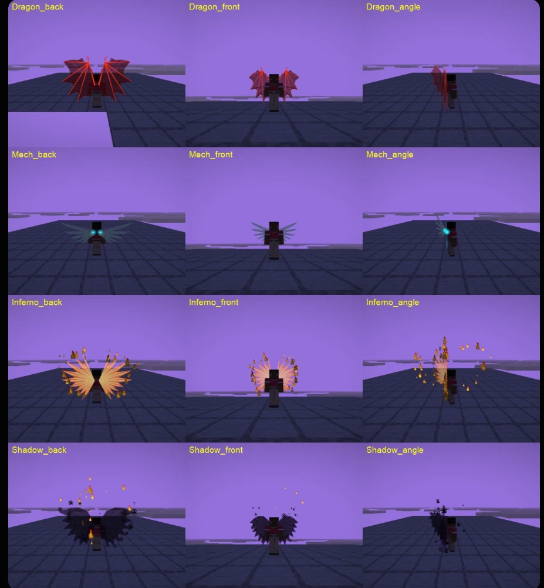

# Larper Client

**An addon for [Meteor Client](https://meteorclient.com/)**, made for **visuals** and **automation**. It works on **DonutSMP** too, and has a DonutSMP region finder built in.

**Free to use.** Download it, use it, change it and share it. See [License](#license).



## Download

Get the jar for your Minecraft version from the **[Releases](../../releases)** page:

| Minecraft | Jar | Needs |
|---|---|---|
| 1.21.11 | `larper-client-0.1.0-mc1.21.11.jar` | Fabric Loader, Meteor Client for 1.21.11, Java 21 |
| 26.1.2 | `larper-client-0.1.0-mc26.1.2.jar` | Fabric Loader, Meteor Client for 26.1.2, Java 25 |

Put the jar in your `.minecraft/mods` folder next to Meteor Client. The modules show up in the **Larper Client** category.
Custom Sky also needs the [Skyboxify](https://modrinth.com/mod/skyboxify) mod.

## Modules

### Visuals (only you see them)
| Module | What it does |
|---|---|
| Knife | CS2-style knives (butterfly and karambit with animated arms, plus more) in an empty slot or over another item, with an inspect animation |
| Hand Aura | Colours your hand and held item, with swirling particles |
| Wings | Dragon, mech, fire or shadow wings on your back, with an optional halo |
| China Hat | A glowing cone hat on your head |
| Orbit Orbs | Glowing orbs circling you |
| Trail | A glowing ribbon behind you |
| Jump Rings | Shockwave rings when you jump and land |
| Cinematic Death | A sword to the liver, a last look, then they go limp. Players rise as angels |
| Custom Sky | Any image or **GIF link** as your sky (animated GIFs play) |
| Custom Totem | Your own totem image and pop sound (with speed, start and end controls) |
| Skin Changer | Wear any skin: a PNG file or any player's username |
| Compass | A compass strip with directions and degrees |
| BPS | Your speed in blocks per second |
| Hit Sounds | Your own sound when a hit lands |

### Automation
| Module | What it does |
|---|---|
| Auto Firework | Elytra autopilot: holds a height with rockets from your hotbar, with human-like timing |
| Fast Place | Places blocks or uses items faster, with LiquidBounce-style settings |
| TNT Cart Assist | Predicts your flame-bow arrow and places a rail and TNT minecart in its path (normal reach only) |
| Key Wind Charge | Throws a wind charge with one key |
| Twerk | Crouches and uncrouches fast |

### Utility
| Module | What it does |
|---|---|
| Region Route | **DonutSMP:** which way and how far to any region, with blocks N/S/E/W, nether coordinates and a waypoint. Also the `.region` command (`.region 5`, `.region 28 5`) |
| Ore Sim | Shows where ores generate from the world seed (`.seed <seed>`). Ported from Meteor Rejects |
| Turn Off All | Turns off every module at once |

> ⚠️ **Use at your own risk. I'm not responsible for any bans.** Check a server's rules before using it there. Many servers don't allow automation modules.

## More is coming, and I need suggestions

I'll keep adding to this. **I need suggestions:** if you have an idea for a module or a visual, or find a bug, [open an issue](../../issues).

## Building it yourself

Each Minecraft version has its own folder:

```
cd mc-1.21.11     # or mc-26.1.2 (needs JDK 25)
./gradlew build   # the jar ends up in build/libs/
```

## Credits

- [Meteor Client](https://github.com/MeteorDevelopment/meteor-client) and its addon template.
- Ore Sim is ported from [Meteor Rejects](https://github.com/AntiCope/meteor-rejects) (GPL-3.0).
- The butterfly and karambit viewmodel frames come from the [CS:GO Hands](https://www.curseforge.com/minecraft/mc-mods/cs-go-hands) mod by StsThorn (MIT). The license is in the assets folder.
- The DonutSMP region layout matches [Glazed](https://github.com/realnnpg/glazed)'s Region Map.

## License

Free to use under the [GNU GPL v3](LICENSE): you can use, change and share it. If you share a changed version, it has to stay open source under the same license.
